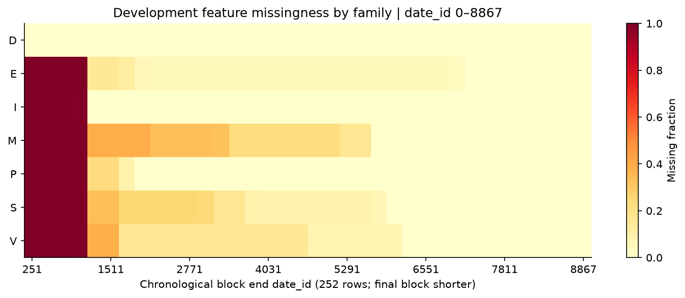
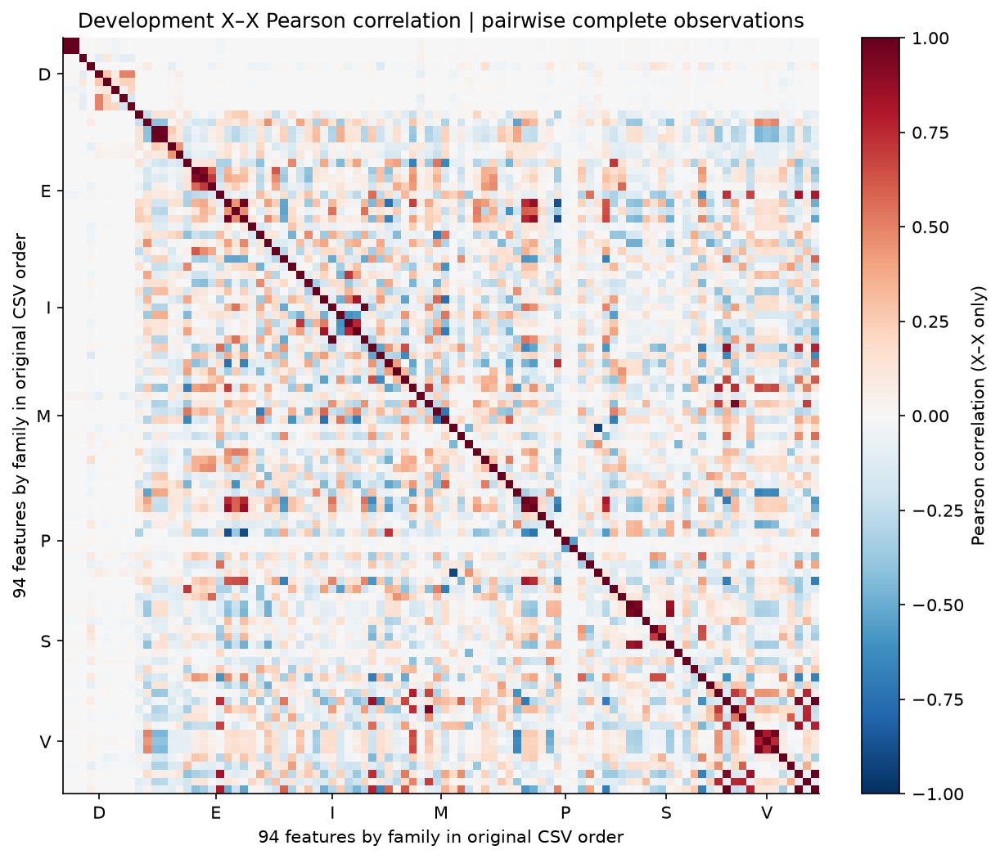
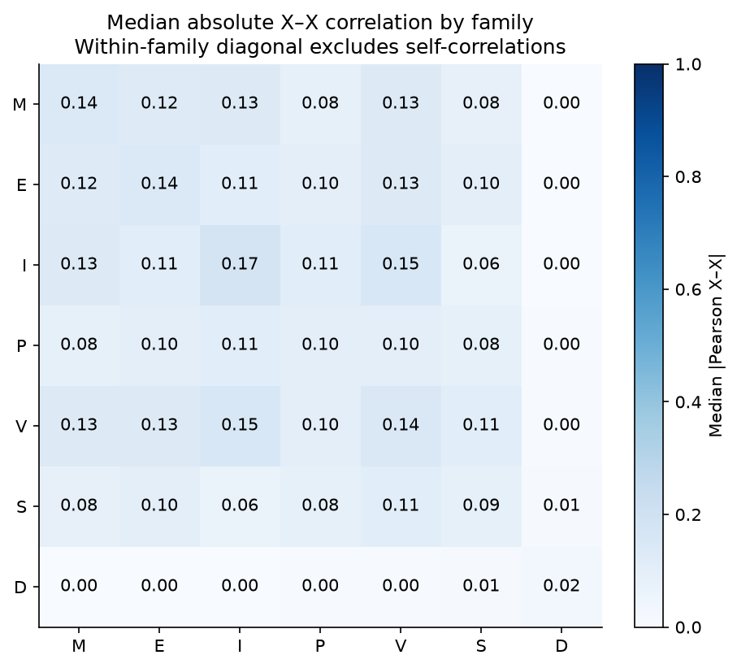
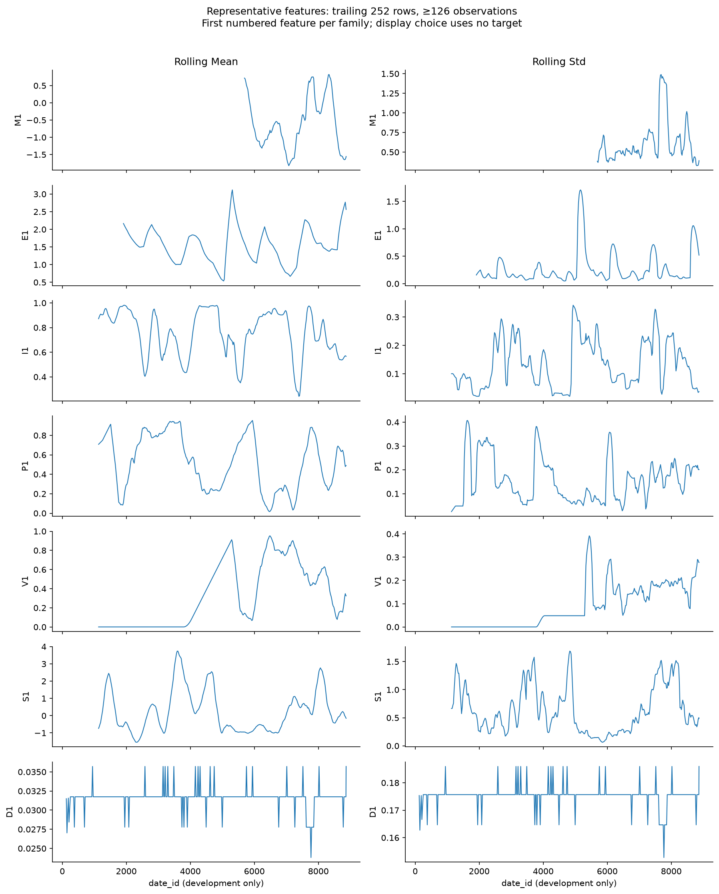
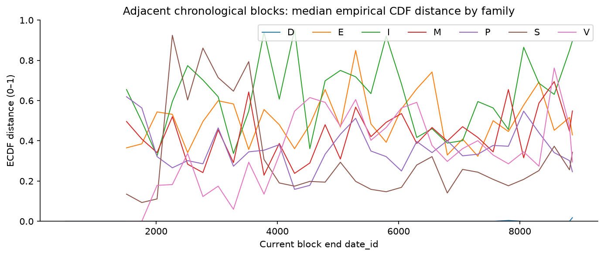
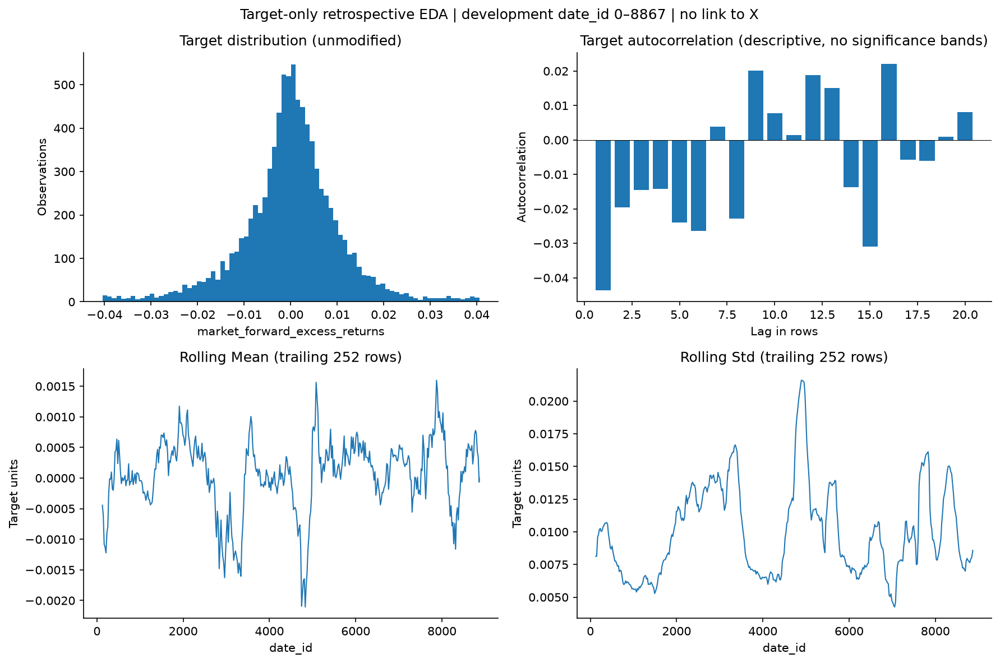

> Historical snapshot. For current research rules and validation settings, see [research_protocol.md](../docs/research_protocol.md).

# Phase 2 — Data Processing & EDA

Generated (UTC): 2026-10-17T08:44:34.802668+00:00. Source: existing hash-verified official Hull Tactical files only.

The superseded Phase 2 alpha/model results and split were withdrawn. This report describes only the rebuilt descriptive phase.

## Boundary and provenance

| Area | date_id | Rows | Columns | Permitted access |
| --- | --- | --- | --- | --- |
| Full train | 0–9047 | 9048 | 98 | Hashes, headers, IDs |
| Development | 0–8867 | 8868 | 98 | Data processing and EDA |
| Competition Simulation | 8868–9047 | 180 | 98 | Locked; headers, IDs, counts only |

No gap or overlap exists. Simulation feature/target values were not parsed. Schema compatibility means a shared header in train.csv; no simulation dtype inference, duplicate-value check or missingness statistics were performed.

Official test.csv is inference-schema/API material only. Its 10 IDs (8980–8989) overlap the locked period. Only its header and IDs were inspected; no feature, lagged-label or target statistics were computed.

The original Phase 1 full-file audit and dictionary predate this firewall and remain byte-identical historical evidence. They are not inputs to new processing choices. This rebuild cannot erase earlier inspection or make these periods historically unseen.

All 13 manifest-listed official files and the ZIP passed integrity verification. Train SHA-256: `8c1aba83e1bf34f91b234b7979f1fc7c397186b33a8d08bdd3634c08eb3810ca`.

## Development schema and quality

All 94 anonymous features, date_id and all three original outcomes are retained. Development shape: 8868 × 98; duplicate full rows: 0; duplicate IDs: 0; chronological: True; infinite cells: 0.

Outcomes are forward_returns, risk_free_rate and market_forward_excess_returns. No target shifting, imputation, winsorization, outlier deletion or feature filtering was performed. Dtypes for all 98 development columns are recorded in phase2_data_summary.json.

## Missingness

85 of 94 features contain missing values: 137,675 cells (16.52% of development feature cells). All-missing features: []; constant observed features: [].

Missingness summary includes every feature's count/fraction, first/last observation, leading/trailing runs and longest contiguous missing run. missing_intervals.csv records every contiguous interval; feature_time_blocks.csv and family_time_blocks.csv record chronological changes.

| feature | missing_count | missing_fraction | leading_missing_rows | longest_missing_run |
| --- | --- | --- | --- | --- |
| E7 | 6969 | 0.785859 | 6969 | 6969 |
| V10 | 6049 | 0.682115 | 6049 | 6049 |
| S3 | 5733 | 0.646482 | 5733 | 5733 |
| M1 | 5547 | 0.625507 | 5547 | 5547 |
| M13 | 5540 | 0.624718 | 5540 | 5540 |
| M14 | 5540 | 0.624718 | 5540 | 5540 |
| M6 | 5043 | 0.568674 | 5043 | 5043 |
| V9 | 4539 | 0.51184 | 4539 | 4539 |
| S12 | 3537 | 0.39885 | 3537 | 3537 |
| M5 | 3283 | 0.370207 | 3283 | 3283 |

## Family scale and distributions

Only the observed M, E, I, P, V, S and D families are used; no MOM family exists. Family summaries are medians across member-level statistics, not pooled standardized scores. Units vary; family scale differences have no inferred economic meaning.

| family | features | missing_count | missing_fraction | median_feature_mean | median_feature_std | smallest_feature_std | largest_feature_std | median_abs_feature_skewness | median_feature_excess_kurtosis |
| --- | --- | --- | --- | --- | --- | --- | --- | --- | --- |
| M | 18 | 41254 | 0.258445 | 0.166018 | 1.05893 | 0.195697 | 1.56411 | 0.500139 | -0.312346 |
| E | 20 | 27471 | 0.154888 | 0.122536 | 0.492867 | 0.012182 | 1.98566 | 1.10869 | 1.88066 |
| I | 9 | 9054 | 0.113442 | 0.551702 | 0.32816 | 0.243277 | 1.65342 | 0.407246 | -0.330178 |
| P | 13 | 14888 | 0.129142 | 0.495701 | 0.818191 | 0.284115 | 1.453 | 0.897055 | 0.231322 |
| V | 13 | 23170 | 0.200982 | 0.282517 | 0.347942 | 0.306559 | 1.3342 | 0.791966 | -0.497949 |
| S | 12 | 21838 | 0.205214 | 0.341339 | 0.639433 | 0.288947 | 1.43259 | 0.181344 | -0.862622 |
| D | 9 | 0 | 0 | 0.0478124 | 0.349848 | 0.175175 | 0.493812 | 2.04272 | 2.17318 |

All 94 feature_statistics.csv rows include mean, sample standard deviation, median, 1/5/25/75/95/99% quantiles, min/max, sample skewness and excess kurtosis. The following largest absolute-skew examples are descriptive display choices, not candidate features or a predictive ranking. No observations are removed.

| feature | observed | min | max | skewness | excess_kurtosis |
| --- | --- | --- | --- | --- | --- |
| E8 | 7862 | -2.45732 | 35.8601 | 6.09032 | 90.3968 |
| E4 | 7862 | 0.000661376 | 0.383267 | 5.61096 | 37.3429 |
| D1 | 8868 | 0 | 1 | 5.348 | 26.6071 |
| D2 | 8868 | 0 | 1 | 5.348 | 26.6071 |
| P6 | 7230 | -0.780115 | 15.6693 | 5.30329 | 41.5538 |
| E14 | 7862 | 0.000661376 | 0.118386 | 4.97929 | 28.7083 |
| E7 | 1899 | -19.919 | 3.50999 | -4.69821 | 31.0477 |
| D7 | 8868 | 0 | 1 | 4.35322 | 16.9544 |

## Discrete encodings

| feature | kind | value |
| --- | --- | --- |
| D1 | binary | 0, 1 |
| D2 | binary | 0, 1 |
| D3 | binary | 0, 1 |
| D4 | binary | 0, 1 |
| D5 | binary | 0, 1 |
| D6 | binary | -1, 0 |
| D7 | binary | 0, 1 |
| D8 | binary | 0, 1 |
| D9 | binary | 0, 1 |

D6's two-state -1/0 encoding is preserved. No numbered anonymous field is assigned a specific economic interpretation.

## Temporal distributions

Rolling means/std use trailing 252 rows including the displayed row and require 126 observed values; they are sampled every 21 rows for display. Target rolling summaries describe realized labels retrospectively and are not forecast-time features. No centered, backward-looking-from-the-future or full-sample normalizer is applied.

Drift compares each chronological block of up to 252 rows with its immediately preceding block, using only information available at that block end. It reports empirical CDF distance, mean change in prior standard deviations and scale ratio; each block needs at least 20 observations. Missing/constant histories yield undefined statistics. These are descriptive distribution changes, not formal structural breaks, regimes or causal effects.

Among 2,747 sufficiently observed adjacent feature-block pairs, median ECDF distance is 0.3413 and the 95th percentile is 0.9921. The final block has 48 rows; shorter-block noise and missingness affect comparisons.

## X–X correlation structure

Pairwise-complete Pearson correlations use development X only and require 126 paired observations. 7 distinct pairs have |correlation| ≥ 0.95; no column is dropped. Every pair's observation count is retained. Family summaries use absolute off-diagonal correlations, including within-family diagonals that exclude self-pairs.

Pairwise deletion can produce a non-positive-semidefinite matrix. Overlapping coverage, common trends, nonstationarity and dependent rows limit interpretation; no predictive or causal conclusion follows.

## Target-only EDA

No feature appears in this analysis. Target statistics use only development market_forward_excess_returns in its supplied units and original row alignment; the label is not reconstructed as the difference of other outcomes.

| rows | missing_count | mean | median | std | min | max | skewness | excess_kurtosis |
| --- | --- | --- | --- | --- | --- | --- | --- | --- |
| 8868 | 0 | 4.25195e-05 | 0.000247829 | 0.0105568 | -0.0404755 | 0.0405511 | -0.170209 | 2.20265 |

| q01 | q05 | q25 | q75 | q95 | q99 |
| --- | --- | --- | --- | --- | --- |
| -0.0317831 | -0.0180874 | -0.0047925 | 0.00547419 | 0.0164241 | 0.0310638 |

The five smallest and five largest development observations are retained in the ignored target_extreme_observations.csv. Target autocorrelation at lags 1–20 is descriptive, with pair counts and no hypothesis tests. No target value is joined to any feature.

## Processing framework

Default processed development.csv preserves all 8,868 rows, 98 columns, original values, encodings and NaNs. This is an identity export, not fitted preprocessing. Missingness is investigated before choosing a treatment.

Future candidates: retain NaN; a median fitted inside each historical training window and used only on subsequent observations; expanding strictly prior median; contemporaneous missing indicators. Optional past-only median/indicator helpers are software-tested but are not applied to the default export. Leading gaps stay NaN when no past value exists. No global mean/median, backward fill or full-development statistic is used to transform historical rows.

## Future validation — design only

Future alpha/model development will use expanding-window walk-forward inside date_id 0–8867. Fold count, initial window, validation lengths, internal holdout length, outcome-availability gap, models and hyperparameters remain undecided. After development, define an internal holdout, freeze the strategy and only then authorize the final 180-row Kaggle-style simulation. No folds, models, signals, allocation or backtest have run in this rebuilt phase.

## Figures

## Reproduction and artifacts

Run `python -m src.cli phase1`, `python -m src.cli phase2` and `python -m pytest`. The protected Phase 1 command verifies existing files and preserves its historical audit; it cannot auto-download while the split policy is active. Notebook 02 executes the same data-only pipeline from raw files, writes all artifacts and displays actual aggregate results.

Generated artifacts include split_definition.json, phase2_data_summary.json, missingness_summary.csv, feature_statistics.csv, family_statistics.csv, missing_intervals.csv, discrete_value_counts.csv, feature/family time blocks, trailing statistics, descriptive drift, X–X correlations/pair counts and target-only tables. Raw, processed and observation-level artifacts remain ignored.

No alpha discovery, predictive feature selection, model fitting, allocation optimization, or backtesting has been performed in the rebuilt Phase 2.
