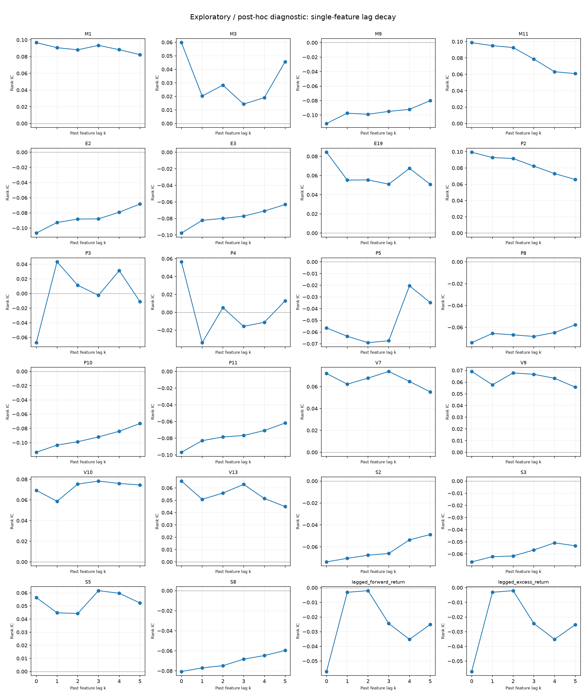
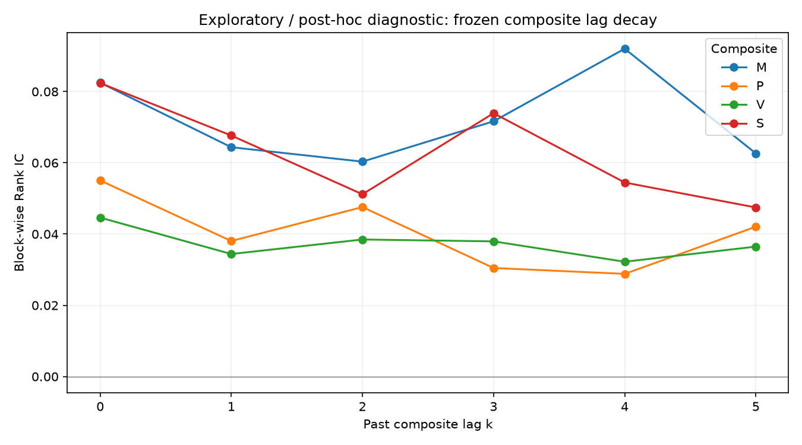
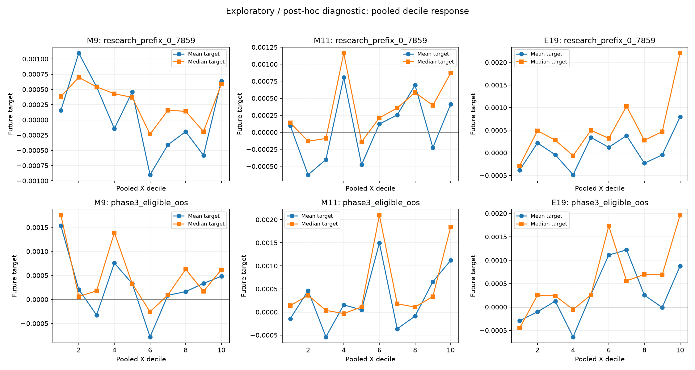
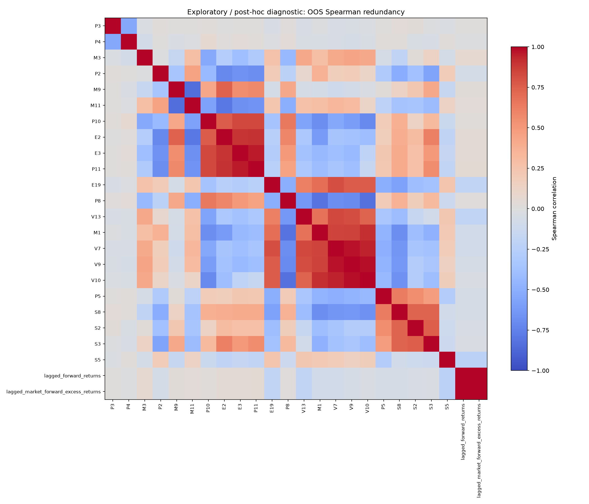
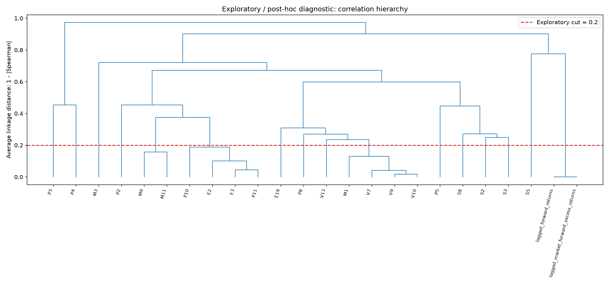

# Phase 3 Post-hoc Diagnostic Analysis

## Purpose

**This analysis is post-hoc and does not alter the pre-registered Phase 3 conclusions.**
All tables and figures are exploratory / post-hoc diagnostics. No new p-values, BH/BY tests, formal grades, model features or trading decisions are produced.
The diagnostic objects are the sealed 24 single-feature PASS and 4 composite PASS from `5b0b25b08f93be373bcb0049340ce5ce5cd45987` / `phase3-pipeline-v1`; their formal labels remain unchanged.

Value-bearing input is restricted to date_id 0–7859 via the existing safe research-prefix loader. Primary diagnostic IC uses the original eligible OOS folds (5088–7859), frozen complete-pair block ranks and original time positions. Shifts occur before slicing; no gap compression, refitted availability or validation direction choice is used.
Composites replay saved members/directions/required counts and hash-verified training percentile references. Lagging C_t uses the historical fold's actual composite; the first k OOS rows are missing instead of inventing pre-OOS composites. k=0 Rank IC and pair counts reconcile with all 28 sealed PASS; saved-bound Pearson also reconciles for all 24 singles.

Validation completed: **242 passed, 0 failed, 0 skipped**, including 18 new post-hoc synthetic/unit cases and the existing eight-case synthetic calibration panel. Phase 2.5-v2 normative hashes, the frozen Phase 3 pipeline hash and all 18 protected result files remain unchanged.

## 1. Lag Decay

Magnitude drop = |IC_k0| − |IC_k1|; relative drop divides by |IC_k0|. A ≥75% magnitude loss is an **exploratory display flag only**, chosen for this diagnostic and never a significance, exclusion or PASS rule. Negative relative drops indicate stronger lagged associations. Common-pair estimates separate coverage changes from lag changes.

The display flag is present for 2 of 24 signals: lagged_market_forward_excess_returns, lagged_forward_returns. This flags a lag pattern for interpretation, not evidence of leakage. In particular, a legal t−1 return field can lose its association when moved to t−2; its exact construction audit takes precedence over a generic cliff interpretation.

Other signals retain more k=1 magnitude, but retention is not proof of correct intraday availability. The complete signed trajectories below show whether later lags decay, reverse or rebound; smoothness is not assigned a formal label.

| Signal | IC k=0 | IC k=1 | IC k=2 | IC k=3 | IC k=4 | IC k=5 | Relative magnitude drop |
| --- | --- | --- | --- | --- | --- | --- | --- |
| M1 | 0.09679 | 0.09071 | 0.08815 | 0.09350 | 0.08831 | 0.08242 | 0.06281 |
| M3 | 0.05977 | 0.02030 | 0.02832 | 0.01433 | 0.01907 | 0.04561 | 0.66040 |
| M9 | -0.11154 | -0.09735 | -0.09887 | -0.09487 | -0.09206 | -0.08005 | 0.12725 |
| M11 | 0.09877 | 0.09498 | 0.09276 | 0.07865 | 0.06319 | 0.06090 | 0.03831 |
| E2 | -0.10660 | -0.09266 | -0.08816 | -0.08787 | -0.07908 | -0.06830 | 0.13075 |
| E3 | -0.09761 | -0.08227 | -0.07987 | -0.07714 | -0.07100 | -0.06314 | 0.15718 |
| E19 | 0.08432 | 0.05523 | 0.05545 | 0.05100 | 0.06748 | 0.05084 | 0.34494 |
| P2 | 0.09940 | 0.09286 | 0.09166 | 0.08230 | 0.07311 | 0.06586 | 0.06585 |
| P3 | -0.06722 | 0.04327 | 0.01121 | -0.00245 | 0.03121 | -0.01101 | 0.35629 |
| P4 | 0.05650 | -0.03396 | 0.00524 | -0.01571 | -0.01114 | 0.01283 | 0.39890 |
| P5 | -0.05651 | -0.06360 | -0.06908 | -0.06746 | -0.02045 | -0.03480 | -0.12546 |
| P8 | -0.07405 | -0.06559 | -0.06687 | -0.06834 | -0.06480 | -0.05767 | 0.11420 |
| P10 | -0.11353 | -0.10345 | -0.09870 | -0.09197 | -0.08404 | -0.07312 | 0.08879 |
| P11 | -0.09691 | -0.08298 | -0.07852 | -0.07676 | -0.07085 | -0.06186 | 0.14378 |
| V7 | 0.07195 | 0.06220 | 0.06772 | 0.07383 | 0.06469 | 0.05515 | 0.13556 |
| V9 | 0.06913 | 0.05769 | 0.06788 | 0.06669 | 0.06325 | 0.05566 | 0.16555 |
| V10 | 0.06933 | 0.05873 | 0.07534 | 0.07832 | 0.07597 | 0.07454 | 0.15290 |
| V13 | 0.06562 | 0.05079 | 0.05584 | 0.06293 | 0.05145 | 0.04493 | 0.22599 |
| S2 | -0.07372 | -0.07046 | -0.06759 | -0.06605 | -0.05360 | -0.04877 | 0.04419 |
| S3 | -0.06652 | -0.06221 | -0.06167 | -0.05671 | -0.05083 | -0.05328 | 0.06473 |
| S5 | 0.05648 | 0.04480 | 0.04423 | 0.06169 | 0.05971 | 0.05228 | 0.20685 |
| S8 | -0.08061 | -0.07699 | -0.07482 | -0.06831 | -0.06472 | -0.05961 | 0.04484 |
| lagged_forward_returns | -0.05718 | -0.00314 | -0.00200 | -0.02441 | -0.03524 | -0.02512 | 0.94512 |
| lagged_market_forward_excess_returns | -0.05714 | -0.00312 | -0.00203 | -0.02447 | -0.03516 | -0.02522 | 0.94534 |

Signed k=0→1 reversals: P3, P4. Magnitude retention alone can hide these reversals; they require caution even without the 75% display flag.

Descriptive review of the observed curves: M11, E2, E3, P2, P10, P11, S2 and S8 retain their sign and show progressively smaller IC magnitude across all six lags, consistent with gradual decay. M1 and M9 also retain most of their association with small rebounds; these curves are consistent with persistent inputs, not proof of timely publication. M3 falls from 0.05977 to 0.02030 (66.0% magnitude loss) before rebounding. P3 reverses from −0.06722 to +0.04327 and P4 from +0.05650 to −0.03396; a magnitude-only flag would understate their instability.

The two explicit lagged fields lose about 94.5% magnitude: roughly −0.057 to −0.003. Since X_t is already a t−1 outcome, k=1 relates t−2 outcome information to y_t. This is consistent with shorter-lived return autocorrelation and is not, by itself, a future-timing concern. The one-row construction check found no forward shift.

All four composites retain positive k=1 IC: M loses 22.0%, P 30.9%, V 22.9% and S 17.9%. Their later curves rebound rather than decay monotonically; none shows near-disappearance at k=1. The common-pair calculation gives the same interpretation. Composite n falls from 2772 at k=0 to 2771 at k=1 because the historical C_t series starts at the original first OOS date; no pre-OOS composite is invented.

Composite trajectories (identical exploratory flag, no FDR rerun):

| Signal | IC k=0 | IC k=1 | IC k=2 | IC k=3 | IC k=4 | IC k=5 | Relative magnitude drop |
| --- | --- | --- | --- | --- | --- | --- | --- |
| M | 0.08251 | 0.06438 | 0.06033 | 0.07165 | 0.09203 | 0.06265 | 0.21971 |
| P | 0.05505 | 0.03805 | 0.04758 | 0.03047 | 0.02883 | 0.04206 | 0.30888 |
| V | 0.04462 | 0.03440 | 0.03847 | 0.03795 | 0.03223 | 0.03647 | 0.22907 |
| S | 0.08239 | 0.06766 | 0.05117 | 0.07393 | 0.05447 | 0.04746 | 0.17883 |

[Long lag table](phase3_posthoc_diagnostics/lag_decay.csv), [common-pair diagnostics](phase3_posthoc_diagnostics/lag_decay_summary.csv), [k=0 reconciliation](phase3_posthoc_diagnostics/k0_reconciliation.csv).

## 2. Reverse Return Relationship

For each signal, the following row reports its largest absolute past-return IC among j=1..5. Choosing that row is descriptive reporting, not a new hypothesis or feature selection.

| Signal | Past-return lag j | Rank IC | Pairs |
| --- | --- | --- | --- |
| lagged_market_forward_excess_returns | 1 | 1.00000 | 2772 |
| lagged_forward_returns | 1 | 0.99999 | 2772 |
| V13 | 1 | -0.32608 | 2772 |
| P5 | 3 | 0.27863 | 2772 |
| S5 | 4 | -0.25527 | 2772 |
| E19 | 1 | -0.25345 | 2772 |
| V7 | 1 | -0.19190 | 2772 |
| V9 | 1 | -0.16266 | 2772 |
| V10 | 1 | -0.16054 | 1260 |
| M1 | 1 | -0.15351 | 1764 |
| S2 | 5 | 0.12441 | 2772 |
| M11 | 1 | 0.11317 | 2772 |
| E3 | 1 | 0.10838 | 2772 |
| E2 | 1 | 0.10524 | 2772 |
| P8 | 1 | 0.10485 | 2772 |
| P11 | 1 | 0.10478 | 2772 |
| P10 | 1 | 0.09609 | 2772 |
| S8 | 5 | 0.09602 | 2772 |
| S3 | 5 | 0.09454 | 1512 |
| P2 | 1 | -0.09421 | 2772 |
| M9 | 1 | 0.06645 | 2772 |
| M3 | 1 | 0.05713 | 2772 |
| P4 | 4 | -0.03053 | 2772 |
| P3 | 4 | 0.02733 | 2772 |

The two lagged fields require a separate interpretation: lagged_market_forward_excess_returns is exactly y_(t−1), so reverse j=1 Rank IC=1 is mechanical. lagged_forward_returns is the supplied raw forward return from t−1; its strong relation to the adjusted past target is also expected. Both were reconstructed with an exact one-row backward shift, with first-row NaN and source date offset −1. This is past information, not evidence of a future shift.
[Exact lag timing audit](phase3_posthoc_diagnostics/lagged_field_timing_audit.csv). Anonymous features can encode past market performance; stronger reverse IC alone does not establish future-label contamination.

Outside the two explicit lagged outcomes, the strongest observed past-return associations are V13 (j=1, −0.32608), P5 (j=3, +0.27863), S5 (j=4, −0.25527), and E19 (j=1, −0.25345). Their absolute reverse ICs exceed their future-target k=0 ICs. This is consistent with substantial past-performance encoding. It does not demonstrate label contamination: the reverse test deliberately uses past targets, and anonymous feature release timestamps are not supplied.

## 3. Rank/Pearson Divergence

Deciles are pooled X-only empirical quantile groups in two scopes: the full research prefix and the original eligible OOS subset. They are retrospective descriptive groups, not trained trading thresholds. Tied quantile edges are dropped instead of splitting equal values arbitrarily.
The following additive contributions use the frozen-bound winsorized X, paired centering and the full-sample Pearson denominator. Core + tail contribution equals the saved Pearson IC. The X-tail display uses pooled 1%/99% raw-X quantiles; the target-extreme display uses the largest 1% absolute centered y. Neither diagnostic deletes observations from formal results or winsorizes y.

| Signal | Frozen block Rank IC | Pooled OOS Rank IC | Frozen winsor Pearson | X-core contribution | X-tail contribution | Y-core contribution | Y-extreme contribution |
| --- | --- | --- | --- | --- | --- | --- | --- |
| M9 | -0.11154 | -0.01651 | -0.00004 | 0.00971 | -0.00975 | 0.00600 | -0.00603 |
| M11 | 0.09877 | 0.03086 | 0.02097 | 0.01773 | 0.00324 | 0.01617 | 0.00480 |
| E19 | 0.08432 | 0.07743 | 0.02066 | 0.03719 | -0.01653 | 0.02164 | -0.00099 |

**M9:** OOS lowest/highest-decile mean y = 0.001534/0.000482; median y = 0.001754/0.000619. Raw-X tail/core contributions oppose; extreme-y/core contributions oppose. Descriptive Pearson excluding the X-tail is 0.01093, and excluding extreme-y days is 0.00656. The numbers and decile curve are consistent with nonlinear, tail-sensitive and/or time-varying aggregation; they do not uniquely identify a causal mechanism.

**M11:** OOS lowest/highest-decile mean y = -0.000145/0.001118; median y = 0.000137/0.001843. Raw-X tail/core contributions have the same sign; extreme-y/core contributions have the same sign. Descriptive Pearson excluding the X-tail is 0.02083, and excluding extreme-y days is 0.01854. The numbers and decile curve are consistent with nonlinear, tail-sensitive and/or time-varying aggregation; they do not uniquely identify a causal mechanism.

**E19:** OOS lowest/highest-decile mean y = -0.000295/0.000873; median y = -0.000452/0.001961. Raw-X tail/core contributions oppose; extreme-y/core contributions oppose. Descriptive Pearson excluding the X-tail is 0.04661, and excluding extreme-y days is 0.02620. The numbers and decile curve are consistent with nonlinear, tail-sensitive and/or time-varying aggregation; they do not uniquely identify a causal mechanism.

**Interpretive distinction: the frozen metrics use different aggregation.** Block Rank IC ranks complete pairs within each fold and then pools the ranks. The saved winsorized Pearson pools original-scale values after each fold's training-only clipping. Comparing these is not a pure test of nonlinearity: cross-fold levels, scale and covariance weights can change the pooled statistic. The following fold summaries are arithmetic descriptions of already sealed fold ICs, not new inferential tests.

- **M9:** all 11 saved fold Pearson ICs are negative (−0.16803 to −0.02318; unweighted mean −0.09083), while pooled winsor Pearson is −0.00004 and pooled Rank is only −0.01651 versus block Rank −0.11154. This is consistent with a substantial across-fold aggregation/scale component; it is not well explained as a globally monotone nonlinear curve alone. The pooled deciles are non-monotone, and X-tail/core contributions nearly cancel (+0.00971 and −0.00975); extreme-y/core contributions also nearly cancel. These are two overlapping descriptions, not additive independent causes.
- **M11:** all 11 saved fold Pearson ICs are positive (0.01372 to 0.15857; mean 0.09389), close in scale to block Rank 0.09877. Pooling reduces Rank to 0.03086 and winsor Pearson to 0.02097. Tail and extreme-y contributions reinforce rather than cancel the positive association; removing either group does not restore the block-scale value. The evidence is more consistent with cross-fold aggregation and an irregular pooled decile response than with extreme-day cancellation as the main explanation.
- **E19:** block Rank 0.08432 and pooled Rank 0.07743 remain similar, while winsor Pearson is 0.02066. X-tail contribution −0.01653 offsets a core contribution +0.03719; excluding these raw-X tails descriptively raises Pearson to 0.04661. Largest-1%-|centered y| days contribute only −0.00099, so that specific extreme-y group is not the main cancellation. The decile means/medians are non-monotone and asymmetric, and saved fold Pearson changes sign in folds 9/10. Together these are consistent with tail sensitivity, nonlinear/local response and time variation, not one uniquely identified mechanism.

Other visible aggregation divergences include E2, P2, P10 and P11; their block Rank magnitudes exceed their pooled Rank magnitudes. All 24 metric comparisons are shown below. No diagnostic statistic replaces the frozen estimator or changes any formal label.

All 24 PASS signals, including other pooled-versus-block divergences (no new selection or gate):

| Signal | Frozen block Rank IC | Pooled OOS Rank IC | Raw Pearson | Frozen winsor Pearson |
| --- | --- | --- | --- | --- |
| M1 | 0.09679 | 0.10650 | 0.07131 | 0.07453 |
| M3 | 0.05977 | 0.06643 | 0.06883 | 0.06345 |
| M9 | -0.11154 | -0.01651 | -0.00276 | -0.00004 |
| M11 | 0.09877 | 0.03086 | 0.02003 | 0.02097 |
| E2 | -0.10660 | -0.04736 | -0.04767 | -0.04740 |
| E3 | -0.09761 | -0.05005 | -0.05423 | -0.05096 |
| E19 | 0.08432 | 0.07743 | 0.03510 | 0.02066 |
| P2 | 0.09940 | 0.03775 | 0.04939 | 0.04859 |
| P3 | -0.06722 | -0.06943 | -0.07223 | -0.07220 |
| P4 | 0.05650 | 0.05294 | 0.05991 | 0.05992 |
| P5 | -0.05651 | -0.04116 | -0.01971 | -0.01915 |
| P8 | -0.07405 | -0.07255 | -0.06513 | -0.06281 |
| P10 | -0.11353 | -0.05323 | -0.05564 | -0.05559 |
| P11 | -0.09691 | -0.03519 | -0.03864 | -0.03848 |
| V7 | 0.07195 | 0.06764 | 0.03912 | 0.04014 |
| V9 | 0.06913 | 0.06106 | 0.03536 | 0.04329 |
| V10 | 0.06933 | 0.08272 | 0.03686 | 0.04367 |
| V13 | 0.06562 | 0.07072 | 0.06389 | 0.03822 |
| S2 | -0.07372 | -0.04651 | -0.03129 | -0.03098 |
| S3 | -0.06652 | -0.03302 | -0.02950 | -0.03070 |
| S5 | 0.05648 | 0.05490 | 0.06207 | 0.05934 |
| S8 | -0.08061 | -0.05348 | -0.04637 | -0.04472 |
| lagged_forward_returns | -0.05718 | -0.05108 | -0.08062 | -0.07360 |
| lagged_market_forward_excess_returns | -0.05714 | -0.05103 | -0.08092 | -0.07346 |

All 24 signals: [decile table](phase3_posthoc_diagnostics/decile_analysis.csv), [Rank/Pearson and tail contributions](phase3_posthoc_diagnostics/rank_pearson_divergence.csv), [frozen fold diagnostics](phase3_posthoc_diagnostics/fold_level_diagnostics.csv).

## 4. Redundancy

Average linkage on 1−|pooled OOS Spearman| gives **16 exploratory clusters** at cut distance 0.2. Negative orientation is treated as redundant information. This is a descriptive grouping, not a count of statistically independent Alphas.
Only pairwise complete observations in each feature's frozen eligible OOS folds are used. Pair counts are saved; a supplementary block-wise correlation matrix removes pooled block-level shifts. Undefined pair distances, if any, are set to 1 for clustering.

| Cluster | Count | Members | Mean \|within correlation\| |
| --- | --- | --- | --- |
| 1 | 4 | M1;V7;V9;V10 | 0.91808 |
| 2 | 1 | M3 | undefined |
| 3 | 2 | M9;M11 | 0.84282 |
| 4 | 4 | E2;E3;P10;P11 | 0.86477 |
| 5 | 1 | E19 | undefined |
| 6 | 1 | P2 | undefined |
| 7 | 1 | P3 | undefined |
| 8 | 1 | P4 | undefined |
| 9 | 1 | P5 | undefined |
| 10 | 1 | P8 | undefined |
| 11 | 1 | V13 | undefined |
| 12 | 1 | S2 | undefined |
| 13 | 1 | S3 | undefined |
| 14 | 1 | S5 | undefined |
| 15 | 1 | S8 | undefined |
| 16 | 2 | lagged_forward_returns;lagged_market_forward_excess_returns | 0.99999 |

Exploratory cut sensitivity:

| Distance cut | Clusters |
| --- | --- |
| 0.10000 | 20 |
| 0.20000 | 16 |
| 0.30000 | 12 |

All high-correlation pairs (|Spearman|≥0.8; display threshold only):

| Feature A | Feature B | Pearson | Spearman | Block-wise Spearman | Pairs |
| --- | --- | --- | --- | --- | --- |
| lagged_forward_returns | lagged_market_forward_excess_returns | 0.99999 | 0.99999 | 0.99999 | 2772 |
| V9 | V10 | 0.98646 | 0.98191 | 0.96291 | 1260 |
| V7 | V9 | 0.97773 | 0.97562 | 0.95345 | 2772 |
| E3 | P11 | 0.87812 | 0.95466 | 0.92998 | 2772 |
| V7 | V10 | 0.93753 | 0.94130 | 0.88840 | 1260 |
| M1 | V10 | 0.89726 | 0.90653 | 0.86143 | 1260 |
| E2 | P11 | 0.92272 | 0.90251 | 0.95329 | 2772 |
| E2 | E3 | 0.90166 | 0.89672 | 0.93343 | 2772 |
| M1 | V9 | 0.87182 | 0.85402 | 0.85091 | 1764 |
| M1 | V7 | 0.84894 | 0.84910 | 0.84118 | 1764 |
| M9 | M11 | -0.77599 | -0.84282 | -0.70633 | 2772 |
| P10 | P11 | 0.88473 | 0.83558 | 0.87319 | 2772 |
| E3 | P10 | 0.76995 | 0.83465 | 0.82998 | 2772 |
| V7 | V13 | 0.79294 | 0.83242 | 0.78380 | 2772 |
| P8 | V10 | -0.88998 | -0.82534 | -0.65792 | 1260 |
| V9 | V13 | 0.76374 | 0.82023 | 0.72199 | 2772 |
| M1 | P8 | -0.85602 | -0.81837 | -0.66120 | 1764 |
| E19 | V7 | 0.86936 | 0.81217 | 0.75260 | 2772 |

There are 18 displayed pairs above |Spearman|=0.8. A high pair need not share a final cluster: average linkage uses all cross-member distances. Pairwise missingness means different pairs can use different dates; for example, M1 uses 1764 observations and V10 1260. The 16-cluster grouping includes four multi-member groups and 12 singletons. Cuts of 0.1 and 0.3 give 20 and 12 clusters, respectively, so the number is sensitive to the exploratory cut and is not evidence of 16 independent information sources.

## 5. Overall Diagnostic Assessment

These are overlapping diagnostic labels only; none changes PASS/FAIL/NOT_TESTABLE:

- **Potential timing concern:** M3, P3 and P4 require caution because of the sharp first-step reduction or signed reversal described above. No anonymous signal meets the 75% magnitude-loss display flag, and none of these observations proves a wrong publication timestamp. The two legal lagged outcomes show a cliff but pass the exact t−1 audit; that expected past-return structure is not classified as leakage. Anonymous release cutoffs remain unverified.
- **No obvious timing concern:** M1, M9, M11, E2, E3, E19, P2, P5, P8, P10, P11, V7, V9, V10, V13, S2, S3, S5, S8. This means only that no obvious cliff or first-step reversal was identified in this descriptive review; it is not a certification of executable availability. The two lagged outcomes additionally pass the exact t−1 construction audit.
- **Strong redundancy:** M1;V7;V9;V10, M9;M11, E2;E3;P10;P11, lagged_forward_returns;lagged_market_forward_excess_returns. No representative feature has been selected.
- **Unusual nonlinear structure:** M9, M11 and E19 show the sealed Rank/Pearson divergence discussed above. Deciles, tails and pooled-versus-block ranks describe possible mechanisms; none creates a new formal grade.

No direct evidence of a future shift was found in the explicit lagged-field construction. This analysis cannot certify the anonymous features' intraday availability or rule out all timing contamination. Synthetic cases verify diagnostic behavior, not the provenance of real anonymous inputs.

No Phase 4 model, feature selection, allocation, backtest, Kaggle score, Internal Holdout or Final-180 evaluation was performed. Formal report/artifact hashes were checked before and after diagnostics.

This post-hoc diagnostic analysis does not alter the frozen Phase 3 PASS/FAIL/NOT_TESTABLE conclusions.
No Internal Holdout or Final-180 data were used.
