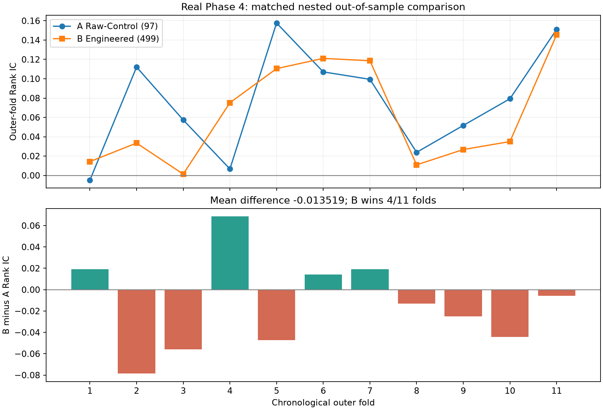
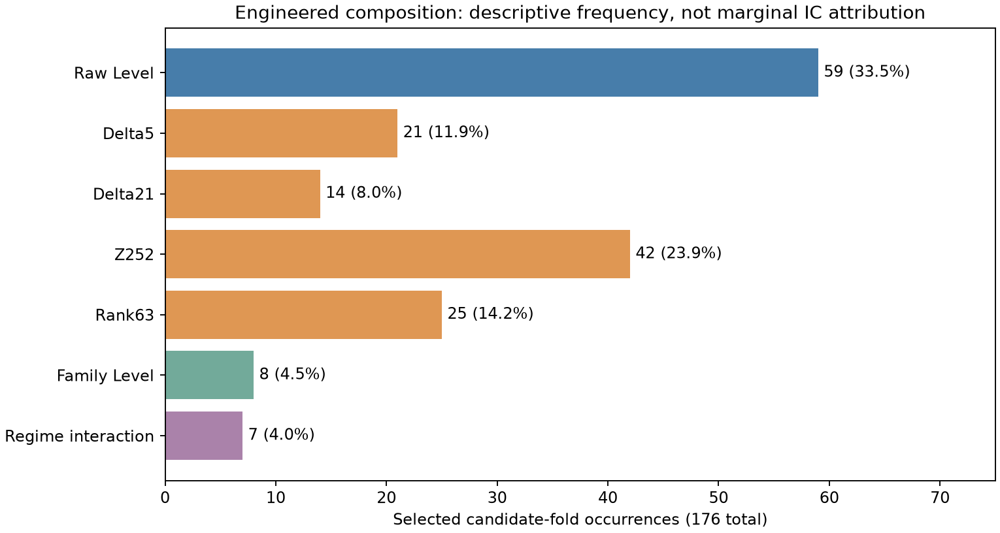
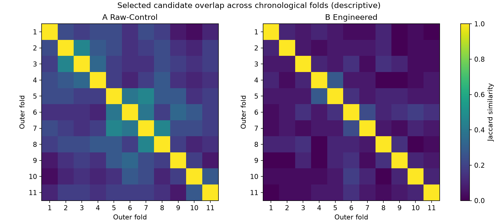

# Phase 4 Real Engineered Alpha Research

**The engineered candidate expansion did not improve nested out-of-sample predictive performance relative to the matched raw-control benchmark.** A mean fold Rank IC was 0.076468, versus 0.062949 for B (B-A -0.013519). B outperformed A in 4/11 folds. All comparisons below are descriptive; no new significance test or selection rule was added.

## Run Identity

| Item | Recorded value |
| --- | --- |
| Protocol | `protocol-v3.1` / `4ce62ab8f5a1dde62b2d682b1e5b1ae008e71f7b` |
| Protocol lock SHA-256 | `23c63be206ca150b99e0ac5a1aca22a133b2f27c170732470daef135a8955815` |
| Frozen pipeline | `phase4-engineered-pipeline-v1.1` / `40ad107082404a0889470bb68d2254b746200951` |
| Pipeline code SHA-256 | `c5c3bd0fdf529fc14db0e90543c6fae2ff488de9a91f4cbef21fc2689b269415` |
| Source train SHA-256 | `8c1aba83e1bf34f91b234b7979f1fc7c397186b33a8d08bdd3634c08eb3810ca` |
| Run creation timestamp (UTC) | `2026-10-19T13:26:27.276295+00:00` |
| Research range | date_id 0-7859, 7860 labelled rows |
| Outer OOS range | date_id 5088-7859, 2772 paired observations per pipeline |
| Run status | completed; clean worktree at entry; actual data-byte hashes verified |
| Attempt ledger | one v1 pre-data KeyError failure; one completed v1.1 research run |
| Holdout / Final | no observations parsed or used |

The [v1 incident](phase4_incidents/v1_real_entry_key_error.md) and its [original state](phase4_incidents/phase4_execution_state_v1.json) remain preserved. The v1 SHA-256 is `958233157fdf1e273ced45b6ade587bf69d75089fd4da3bf840a0bd86e865228`; the v1.1 state and manifest embed that record and hash. v1 was neither reset nor deleted. v1.1 was executed once under separate authorization after the loader-only fix and a new annotated freeze. This is not a claim that only one CLI attempt ever occurred across both versions.

All ten original output files and both state files were copied byte-for-byte into [the sealed snapshot](phase4_real_run/snapshot_seal.json). Their original hashes match. `run_state=completed` in the manifest and `state=completed` / `reservation_consumed=true` in the v1.1 state describe the completed run; the retained `real_run_state=unused` field is inherited preflight metadata, not a current permission to rerun. The canonical single-run guard now refuses another attempt. File-byte hashing covers the full source file; the only observation parser is the existing bounded `read_csv(nrows=7860)`. No held-out X-Y observations entered research.

## Raw-Control

A used all 97 registered raw-Level candidates (94 anonymous plus three official lagged fields), without a Phase 3 PASS prefilter. Every outer fold independently applied the shared nested selector using only its purged training prefix. A produced 11 finite OOS ICs, with 10/11 positive folds and exactly 16 selected candidates per fold.

## Engineered

B exposed the frozen registry of 499 candidates: 97 x five representations plus seven family Levels and seven High-V interactions. All transformations, availability checks, family fits, X-only regime thresholds, signs and maps followed the frozen rules. B also produced 11 finite OOS ICs, with 11/11 positive folds and 16 selected candidates per fold. It had a better worst fold and slightly lower IC dispersion, but a lower mean, median and mean-fold Pearson IC than A.

| Metric | A | B |
| --- | --- | --- |
| mean_fold_ic | 0.076468 | 0.062949 |
| median_fold_ic | 0.079287 | 0.034999 |
| ic_std | 0.054899 | 0.052465 |
| positive_folds | 10 | 11 |
| worst_fold_ic | -0.004938 | 0.001311 |
| best_fold_ic | 0.157636 | 0.145449 |
| blockwise_pooled_rank_ic | 0.076468 | 0.062949 |
| mean_fold_pearson_ic | 0.068919 | 0.052011 |
| mean_selected_count | 16 | 16 |

IC std uses ddof=1. Mean-fold Pearson is the descriptive arithmetic mean of the pipeline's eleven recorded Pearson ICs; predictions were clipped only by their frozen training inner-OOF 1%/99% bounds, while validation y was not clipped. Original summaries and every fold's Pearson IC remain in the sealed CSVs.

## Fair Comparison

**The Raw-Control and Engineered pipelines used exactly the same nested selection procedure; the registered candidate universe was the planned systematic difference.** Both used 11 expanding outer folds (initial training 5087, validation/step 252, purge=1), two 252-row chronological inner blocks with a preceding purge, identical transformed-series eligibility, same nonzero inner-IC sign requirement, absolute mean-inner-IC ranking, training-only greedy |Spearman| >=0.90 redundancy, Top-16, sign alignment, training mid-ECDF normalization and fixed equal weights. No outer labels chose candidates or fitted state.

Both pipelines were structurally available in all eleven blocks. Each paired fold used exactly 252 common observations (100% coverage), so no fold or date was dropped to improve the comparison. The registered primary summary is the equal mean of the eleven fold Rank ICs.

- Mean B-A: **-0.013519**.
- Median(B) minus median(A): **-0.044288**.
- Median of the eleven paired fold differences: **-0.012933**.
- B won **4/11** folds, lost **7/11**, and tied **0**.

| fold_id | validation_start | validation_end | A_rank_ic | B_rank_ic | B_minus_A | A_pearson_ic | B_pearson_ic | A_selected | B_selected |
| --- | --- | --- | --- | --- | --- | --- | --- | --- | --- |
| 1 | 5088 | 5339 | -0.004938 | 0.014290 | 0.019228 | 0.048073 | 0.034855 | 16 | 16 |
| 2 | 5340 | 5591 | 0.112076 | 0.033432 | -0.078643 | 0.072106 | 0.014033 | 16 | 16 |
| 3 | 5592 | 5843 | 0.057355 | 0.001311 | -0.056044 | 0.083713 | -0.002144 | 16 | 16 |
| 4 | 5844 | 6095 | 0.006670 | 0.075174 | 0.068504 | 0.001822 | 0.087109 | 16 | 16 |
| 5 | 6096 | 6347 | 0.157636 | 0.110466 | -0.047169 | 0.160296 | 0.122175 | 16 | 16 |
| 6 | 6348 | 6599 | 0.107063 | 0.121072 | 0.014009 | 0.060680 | 0.080139 | 16 | 16 |
| 7 | 6600 | 6851 | 0.099408 | 0.118588 | 0.019179 | 0.121602 | 0.182754 | 16 | 16 |
| 8 | 6852 | 7103 | 0.023853 | 0.010920 | -0.012933 | 0.020946 | -0.032333 | 16 | 16 |
| 9 | 7104 | 7355 | 0.051667 | 0.026733 | -0.024934 | 0.020643 | -0.019696 | 16 | 16 |
| 10 | 7356 | 7607 | 0.079287 | 0.034999 | -0.044288 | 0.062782 | 0.009209 | 16 | 16 |
| 11 | 7608 | 7859 | 0.151068 | 0.145449 | -0.005619 | 0.105441 | 0.096023 | 16 | 16 |

This is a descriptive matched comparison, not an added HAC, paired t-test, bootstrap, BH/BY or post-result significance gate. No Phase 6 primary pipeline was selected, and no holdout was unlocked.

## Transformation Contribution

B selected **176 candidate-fold occurrences**. Raw Level accounted for **59/176 (33.52%)**; non-raw-Level candidates accounted for **117/176 (66.48%)**. Family composites named `/Level` are shown separately (8/176); if these are included in the literal Level label, Level is **67/176 (38.07%)**. This distinction avoids calling a family composite an original raw Level signal.

| category | selection_occurrences | selection_share | unique_candidates | folds_selected | mean_inner_rank | mean_B_outer_ic_when_selected |
| --- | --- | --- | --- | --- | --- | --- |
| Level | 59 | 0.335227 | 28 | 11 | 9.559322 | 0.062949 |
| Delta5 | 21 | 0.119318 | 18 | 9 | 10.142857 | 0.050308 |
| Delta21 | 14 | 0.079545 | 13 | 7 | 10.214286 | 0.071823 |
| Z252 | 42 | 0.238636 | 24 | 11 | 10.166667 | 0.062949 |
| Rank63 | 25 | 0.142045 | 20 | 8 | 12.040000 | 0.063185 |
| FamilyLevel | 8 | 0.045455 | 3 | 7 | 8.750000 | 0.066323 |
| RegimeInteraction | 7 | 0.039773 | 5 | 6 | 11.285714 | 0.050503 |

`mean_inner_rank` is the recorded rank before greedy redundancy removal. The last column averages B's full-composite OOS IC over distinct folds where that category was present; it is **descriptive association, not the category's standalone IC or marginal contribution**. No ablation was preregistered or run. Many categories share the same folds, and their candidates are correlated; selection frequencies cannot isolate which transformation caused a performance change.

| fold_id | Level | Delta5 | Delta21 | Z252 | Rank63 | FamilyLevel | RegimeInteraction | raw_level_share | B_outer_rank_ic | B_minus_A |
| --- | --- | --- | --- | --- | --- | --- | --- | --- | --- | --- |
| 1 | 2 | 2 | 3 | 4 | 5 | 0 | 0 | 0.125000 | 0.014290 | 0.019228 |
| 2 | 7 | 2 | 0 | 3 | 4 | 0 | 0 | 0.437500 | 0.033432 | -0.078643 |
| 3 | 5 | 3 | 4 | 1 | 0 | 2 | 1 | 0.312500 | 0.001311 | -0.056044 |
| 4 | 6 | 5 | 1 | 3 | 0 | 1 | 0 | 0.375000 | 0.075174 | 0.068504 |
| 5 | 5 | 2 | 2 | 5 | 0 | 1 | 1 | 0.312500 | 0.110466 | -0.047169 |
| 6 | 8 | 0 | 2 | 3 | 2 | 1 | 0 | 0.500000 | 0.121072 | 0.014009 |
| 7 | 5 | 0 | 0 | 7 | 2 | 1 | 1 | 0.312500 | 0.118588 | 0.019179 |
| 8 | 6 | 1 | 0 | 5 | 1 | 1 | 2 | 0.375000 | 0.010920 | -0.012933 |
| 9 | 4 | 1 | 0 | 4 | 5 | 1 | 1 | 0.250000 | 0.026733 | -0.024934 |
| 10 | 5 | 2 | 1 | 3 | 4 | 0 | 1 | 0.312500 | 0.034999 | -0.044288 |
| 11 | 6 | 3 | 1 | 4 | 2 | 0 | 0 | 0.375000 | 0.145449 | -0.005619 |

Non-Level representations were used extensively, rather than B merely repeating the raw-Level universe. Nevertheless, the expanded composite underperformed the matched raw control on mean OOS Rank IC. These results therefore do not support a positive aggregate incremental benefit from the frozen engineered expansion. No transformation was removed, reweighted or newly whitelisted after observing this result. The anonymous V ordering remains a proxy, not a certification of physical market-volatility ordering.

## Selection Stability

Full [candidate frequencies](phase4_real_analysis/selected_candidate_frequency.csv), [all 55 fold pairs per pipeline](phase4_real_analysis/selection_overlap.csv), and [per-fold transformation counts](phase4_real_analysis/transformation_by_fold.csv) are published. Similarity uses exact registered candidate IDs: Jaccard = intersection/union. Representation changes on the same raw source count as different candidates; this diagnostic is not a new clustering or stability filter.

| pipeline | all_pair_mean_jaccard | all_pair_min_jaccard | all_pair_max_jaccard | adjacent_mean_jaccard | adjacent_min_jaccard | adjacent_max_jaccard | adjacent_mean_shared_candidates |
| --- | --- | --- | --- | --- | --- | --- | --- |
| A | 0.208346 | 0.032258 | 0.454545 | 0.309136 | 0.185185 | 0.454545 | 7.400000 |
| B | 0.077241 | 0.000000 | 0.280000 | 0.134361 | 0.066667 | 0.280000 | 3.700000 |

A used 69 unique candidates across 176 occurrences; B used 111. Adjacent folds shared an average of 7.4/16 candidates for A versus 3.7/16 for B. There is substantial fold-to-fold replacement, particularly in B, alongside a persistent subset of raw signals. No instability threshold was introduced as a formal decision rule.

Most frequently selected raw candidates:

| candidate_id | folds_selected | mean_inner_rank | positive_directions | negative_directions |
| --- | --- | --- | --- | --- |
| raw/P10/Level | 11 | 4.545455 | 0 | 11 |
| raw/M9/Level | 10 | 8.100000 | 0 | 10 |
| raw/M11/Level | 8 | 4.500000 | 8 | 0 |
| raw/P2/Level | 8 | 9.875000 | 8 | 0 |
| raw/E19/Level | 5 | 5.800000 | 5 | 0 |
| raw/M4/Level | 5 | 15.000000 | 0 | 5 |
| raw/P5/Level | 5 | 15.600000 | 0 | 5 |
| raw/P8/Level | 5 | 9.400000 | 0 | 5 |
| raw/S8/Level | 5 | 10.600000 | 0 | 5 |
| raw/V13/Level | 5 | 4.800000 | 5 | 0 |

Most frequently selected engineered-universe candidates (including raw Levels):

| candidate_id | category | folds_selected | mean_inner_rank | positive_directions | negative_directions |
| --- | --- | --- | --- | --- | --- |
| raw/P10/Level | Level | 7 | 7.142857 | 0 | 7 |
| raw/M11/Level | Level | 6 | 8.166667 | 6 | 0 |
| raw/E2/Z252 | Z252 | 5 | 8.200000 | 0 | 5 |
| raw/M9/Level | Level | 5 | 6.800000 | 0 | 5 |
| raw/E19/Level | Level | 4 | 15.250000 | 4 | 0 |
| raw/E19/Z252 | Z252 | 4 | 12.250000 | 4 | 0 |
| raw/P10/Z252 | Z252 | 4 | 15.750000 | 0 | 4 |
| raw/V13/Level | Level | 4 | 12.000000 | 4 | 0 |
| family/M/Level | FamilyLevel | 3 | 3.333333 | 3 | 0 |
| family/S/Level | FamilyLevel | 3 | 9.666667 | 3 | 0 |
| interaction/M/HighV | RegimeInteraction | 3 | 7.666667 | 3 | 0 |
| raw/E2/Level | Level | 3 | 6.333333 | 0 | 3 |

## Integrity and Validation

- Local full suite at the frozen v1.1 source: **399 passed / 0 failed / 0 skipped** ([JUnit evidence](phase4_real_analysis/full_tests.xml)); includes the actual-loader integration test with a 9048-row artificial CSV and held-out sentinels.
- Protocol v3/v3.1, Phase 2.5-v2 and the registered selector/representations/evaluation were not changed for this run. The v1.1 remediation changed only the entry/guards and its tests/docs before the new freeze.
- Frozen pipeline code hash matches the completed manifest. v1 and v1.1 states are retained, and the old v1 record hash is unchanged.
- Original artifacts were not recomputed or overwritten. The [snapshot seal](phase4_real_run/snapshot_seal.json) binds byte-identical output/state copies. Derived descriptive tables and figures live separately in `reports/phase4_real_analysis/`.
- The Internal Holdout and Final Simulation remain locked. Earlier Phase 3/post-hoc observations and descriptive EDA caveats remain disclosed in the protocol; these research folds are not relabelled an untouched confirmatory test.

## Conclusion

**Engineered candidate expansion did not improve nested out-of-sample predictive performance relative to the matched raw-control benchmark.** B had more positive folds and a slightly better worst fold, but its primary mean OOS Rank IC was lower by 0.013519; it lost seven of eleven paired folds and its selected candidates changed more across time. The frozen comparison does not establish additional aggregate predictive information from this engineered universe over A in this research history. This is not a general proof that every transformation is ineffective, nor evidence of a profitable trading strategy.

No post-result feature selection, rule change, reweighting, additional real run, allocation/backtest or Phase 5 model training was performed. Further phases require their own user authorization and frozen procedures.

Real Phase 4 Engineered Alpha Research was completed exactly once under the frozen protocol-v3.1 and phase4-engineered-pipeline-v1.1; the earlier v1 pre-data failure remains recorded.

The Raw-Control and Engineered pipelines used the same nested selection procedure.

Internal Holdout 7860–8867 and Final Simulation 8868–9047 were not parsed or used.

No Phase 5 model training was performed.
