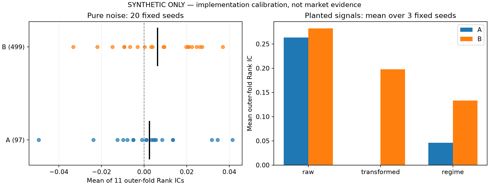

# Phase 4A Synthetic Pipeline Calibration

**Synthetic only. No real Phase 4 research was run.** Both candidate universes use the same nested selector.
The results below concern implementation behavior under the registered artificial generators, not Hull alpha efficacy.

## Frozen design and execution identity

- Protocol: `protocol-v3.1`, commit `4ce62ab8f5a1dde62b2d682b1e5b1ae008e71f7b`; old v3/v2 unchanged.
- Calibration source commit: `ba76060b3400c30b64be0cb95d4337de927ba836`; source worktree dirty: `False`.
- Pipeline source hash: `d526d2cd1402d156569e6b1fcbdf5b086e8cfbb8832a712a52b2043a49b0e17d` (same executable source is bound by the final pipeline tag).
- Configuration/lock identity, Python/numpy/pandas/scipy versions and all seeds: [calibration manifest](phase4_pipeline_synthetic_calibration/calibration_manifest.json).
- A: 97 raw Level candidates; B: 485 raw representations + 7 family Levels + 7 High-V interactions = 499.
- Both: 11 outer folds, initial training 5087 rows, validation/step 252, purge 1; two earlier 252-row inner blocks; Top-K 16; reject training |Spearman rho| >= 0.90 or undefined pair correlation.
- Eligibility: >=252 observations, >=80% post-launch coverage, <=25% trailing504 missingness, >=2 distinct values, checked after transformation in each fitting reference.
- Inner ICs must be finite, nonzero and have the same sign; sort absolute mean then lexical ID. No added IC cutoff, FDR or result-driven retuning.
- Training mid-ECDF maps, fixed sign and equal weights. Missing mapped terms are zero with a fixed denominator, subject to the frozen row-coverage minimum. No-alpha/constant IC remains undefined.
- Pearson bounds use complete earlier inner-OOF selector forecasts, never an outer-fitted selector or outer y.
- Regime uses unsigned eligible V-member training mid-ECDFs, training median, two proxy states; its fitting API has no y. Ordinary alpha family composites retain training-only target signs.

## Pure noise: all 20 fixed seeds

Null target is independent IID N(0,1). Continuous X has within-family AR(1)=0.8 factors with approximately 0.5 contemporaneous correlation; D fields are Bernoulli. Official lagged fields are reconstructed at offset -1. No seed is omitted. Each seed runs both full eleven-fold selectors.

The distribution below is across the **20 seed-level equal means of 11 outer-fold ICs**, rather than 220 folds treated as independent observations.

| pipeline | seeds | mean | std | p05 | p50 | p95 | min | max | alarm_threshold | engineering_alarm |
| --- | --- | --- | --- | --- | --- | --- | --- | --- | --- | --- |
| A | 20 | 0.002423 | 0.020134 | -0.025042 | 0.002226 | 0.034819 | -0.049483 | 0.041468 | 0.020000 | False |
| B | 20 | 0.006310 | 0.018636 | -0.022554 | 0.006464 | 0.027751 | -0.033205 | 0.036923 | 0.020000 | False |

Neither pipeline triggered the preregistered engineering alarm `abs(mean) > max(0.02, 3*sample_std/sqrt(20))`.
This panel provides no indication of systematic null OOS inflation under this generator. It is not proof of nominal false-positive control, market stationarity or real alpha.
Inner selection can still show large apparent ICs by chance; [all seed summaries](phase4_pipeline_synthetic_calibration/per_seed_summary.csv) retain the best apparent inner IC, outer mean/median, positive-fold ratio, extremes and selected counts.



## Planted raw alpha

Registered y = 0.35*M1 - 0.25*E1 + 0.25*P1 + independent N(0,1), seeds 11/22/33.
Correctly signed planted raw-Level selections: A=99, B=50 fold occurrences across the three seeds.
Mean outer IC: A=0.263474, B=0.281916. Raw recovery passed; B retained positive OOS signal under this plant.

| pipeline | candidate_id | sign | selected_fold_occurrences |
| --- | --- | --- | --- |
| A | raw/E1/Level | -1.000000 | 33 |
| A | raw/M1/Level | 1.000000 | 33 |
| A | raw/P1/Level | 1.000000 | 33 |
| B | raw/E1/Level | -1.000000 | 21 |
| B | raw/M1/Level | 1.000000 | 17 |
| B | raw/P1/Level | 1.000000 | 12 |

## Planted transformed alpha

M1 = 0.02*t + epsilon_t; y = 0.6*(epsilon_t-epsilon_(t-21))/sqrt(2) + independent N(0,1). Early missing endpoints are preserved.
Correctly signed M1/Delta21 selections by B: 33 fold occurrences.
Mean outer IC: A=0.000195, B=0.197952; mean B-A=0.197757.
The prespecified transformed-recovery and average-engineered-advantage checks passed. Finite-sample raw IC was not required to equal zero.

## Planted regime interaction

Latent V is AR(1)=0.97; V_j=latent+N(0,0.5^2). P members share an IID common signal plus independent noise std0.2; y=0.8*P_common*1[latent>0]+N(0,1). The latent state is never supplied to the pipeline.
Correctly signed `interaction/P/HighV` selections: 23 fold occurrences.
Mean outer IC: A=0.045848, B=0.133278. Prespecified interaction recovery passed.
The anonymous V proxy's ordering is not a claim about actual realized market volatility.

## All planted seed results

| case | seed | pipeline | mean_fold_ic | positive_fold_ratio | mean_selected_count |
| --- | --- | --- | --- | --- | --- |
| raw | 11 | A | 0.234799 | 1.000000 | 16.000000 |
| raw | 11 | B | 0.262596 | 1.000000 | 16.000000 |
| raw | 22 | A | 0.280790 | 1.000000 | 16.000000 |
| raw | 22 | B | 0.290074 | 1.000000 | 16.000000 |
| raw | 33 | A | 0.274832 | 1.000000 | 16.000000 |
| raw | 33 | B | 0.293077 | 1.000000 | 16.000000 |
| regime | 11 | A | 0.062778 | 0.818182 | 16.000000 |
| regime | 11 | B | 0.128103 | 1.000000 | 16.000000 |
| regime | 22 | A | 0.027452 | 0.727273 | 16.000000 |
| regime | 22 | B | 0.095255 | 0.909091 | 16.000000 |
| regime | 33 | A | 0.047315 | 0.545455 | 16.000000 |
| regime | 33 | B | 0.176475 | 1.000000 | 16.000000 |
| transformed | 11 | A | -0.014499 | 0.454545 | 16.000000 |
| transformed | 11 | B | 0.162779 | 1.000000 | 16.000000 |
| transformed | 22 | A | -0.001914 | 0.454545 | 16.000000 |
| transformed | 22 | B | 0.202438 | 1.000000 | 16.000000 |
| transformed | 33 | A | 0.016998 | 0.636364 | 16.000000 |
| transformed | 33 | B | 0.228639 | 1.000000 | 16.000000 |

## Leakage and software verification

Full suite: **388 passed, 0 failed, 0 skipped**; **65 new Phase 4 tests** (in addition to the earlier 12 v3.1 amendment tests). [JUnit evidence](phase4_pipeline_synthetic_calibration/full_test_results.xml).

| Contract | Outcome |
| --- | --- |
| Future-X changes leave earlier Delta/Z/Rank values unchanged | Passed |
| Rank63 observed-value queue, ties, current NaNs, min32 | Passed |
| Outer-y mutation leaves selection/signs/weights/maps unchanged | Passed for A and B |
| Future-X mutation leaves prior selection, regime and maps unchanged | Passed |
| Regime is invariant even to training-y mutation | Passed |
| Same candidate universe gives identical A/B selector decisions | Passed |
| Transformed eligibility and leading/intermittent/late/recent missingness | Passed |
| Pairwise deletion occurs before redundancy ranking | Passed |
| Sign alignment, fixed denominator, coverage and no-alpha policy | Passed |
| Pearson uses earlier complete OOF selectors | Passed |
| Determinism and lexical tie ordering | Passed |
| Exact A97/B499 registry and A never invokes engineering | Passed |
| Canonical single-use state, failed/interrupted claim, concurrent O_EXCL | Passed |
| Dirty worktree, wrong commit/tag/hash and output bypass rejected | Passed |
| Read-only preflight performs no data verification or selection | Passed |

One initial unit-test fixture incorrectly asserted a rank before the 32nd observation; the fixture was corrected, not the algorithm or protocol. The final suite passed after that correction. No calibration-driven protocol change occurred.

## Audits, commands and limits

Machine evidence: [638 outer-fold rows](phase4_pipeline_synthetic_calibration/outer_fold_results.csv), [all selected candidates](phase4_pipeline_synthetic_calibration/selected_candidates.csv), [noise distribution](phase4_pipeline_synthetic_calibration/noise_distribution.csv).
The [first registered null seed audit](phase4_pipeline_synthetic_calibration/synthetic_audit_example/phase4_run_manifest.json) demonstrates all ten output files, including candidate registry, full selection/eligibility, redundancy partners, fitted-map hashes, regime state, OOF clipping sources and predictions. Full per-run audits for all 29 cases remain in ignored `work/phase4A/calibration/`; aggregated evidence is committed.

```powershell
.\.venv\Scripts\python.exe -m src.research.phase4 --calibrate --workers 3 --workspace work/phase4A/calibration --output reports/phase4_pipeline_synthetic_calibration
.\.venv\Scripts\python.exe -m pytest --basetemp=work/phase4A/full-suite --junitxml=work/phase4A/full-tests.xml -q
.\.venv\Scripts\python.exe -m src.research.phase4 --check
```

Calibration destinations cannot already exist; the recorded run was executed once with all registered seeds. Synthetic workers and the complete pytest session forbid opening the project's real data directory. The preflight command is metadata-only and only passes at the final annotated pipeline tag with a clean worktree and unused canonical state.

All 61 pre-task protected result/protocol files match their recorded hashes; the Phase 2.5-v2 lock and inherited frozen Phase 3 implementation hash pass. Protocol v3/v3.1 were not modified during implementation. This task read no real Phase 4 X-Y, Internal Holdout or Final Simulation observations and created no real-run reservation.

Calibration supports implementation behavior only for these generators and finite seeds. It does not establish market predictability, incremental real engineered alpha, profitable allocation or valid post-selection market inference. Prior descriptive EDA/Phase3/post-hoc observation caveats remain disclosed in the frozen protocol.

The Phase 4 Engineered Alpha pipeline was implemented and frozen before any real Phase 4 X-Y results were observed.

Only synthetic data were used for pipeline validation and calibration.

Internal Holdout 7860–8867 and Final Simulation 8868–9047 remain untouched.

No real Phase 4 run was executed.
